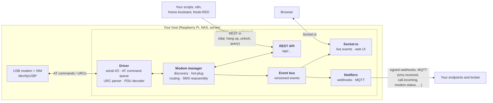

# gsm2http

[](https://github.com/gsm2http/gsm2http/actions/workflows/ci.yml)
[](https://github.com/gsm2http/gsm2http/actions/workflows/docker.yml)
[](https://github.com/gsm2http/gsm2http/actions/workflows/gitleaks.yml)
[](https://github.com/gsm2http/gsm2http/releases)
[](https://github.com/gsm2http/gsm2http/pkgs/container/gsm2http)
[](docs/DEPLOYMENT.md)
[](LICENSE)

**A self-hosted SMS & voice API for the old USB modem in your drawer.**

gsm2http turns a cellular USB modem (2G/3G/4G/LTE) into a small HTTP service. Your scripts and automations call a REST API to send SMS, dial, hang up or unlock the SIM, and gsm2http calls them back with webhooks when a text or call comes in. It runs as one Docker container with a web UI.

A self-hosted, simplified SMS and call-control gateway for personal and small-site use: no per-message fees, no cloud relay, and your messages never leave your network unless you send them somewhere.

> [!WARNING]
> **Alpha software.** It talks directly to your modem and SIM card. It can send SMS and place calls your carrier will bill you for, lock your SIM with wrong PINs, or behave unpredictably on untested firmware. **Try it with a prepaid SIM and a small balance.** You are responsible for your carrier's terms and your local laws. There is no warranty (see [LICENSE](LICENSE)).

> [!NOTE]
> **"GSM" means the command set, not the network generation.** gsm2http speaks the standard AT and SMS commands that started with GSM (3GPP TS 27.005/27.007). 2G/3G and LTE USB sticks use the same commands, so they work too, as long as they expose a serial AT port.

---

## Contents

- [Features](#features)
- [Supported hardware](#supported-hardware)
- [Quick start (Docker)](#quick-start-docker)
- [Configuration](#configuration)
- [Architecture](#architecture)
- [Events and payloads](#events-and-payloads)
- [Security notes](#security-notes)
- [Responsible use](#responsible-use)
- [Documentation](#documentation)
- [Acknowledgements and prior art](#acknowledgements-and-prior-art)
- [License](#license)

## Features

Features marked **Planned** are designed and documented but not built yet. They are due in the first tagged release, `v0.1.0`.

| Status | Feature |
|---|---|
| Available | **Receive SMS** as an `sms.received` event. Long messages are reassembled from their parts. GSM 7-bit and UCS-2 (emoji and non-Latin scripts) are both decoded. |
| Available | **Incoming calls** with caller ID: one `call.incoming` per call, then `call.ended` (missed, completed, busy, …) |
| Available | **Dial** a number for a set time and hang up: useful as a "ring my phone" alarm. This is call *control* only; there is no audio (see [FAQ](docs/FAQ.md#can-it-make-real-voice-calls-with-audio)). |
| Available | **Hang up**, **unlock the SIM with a PIN**, **switch network mode** (2G / 3G / auto), **run diagnostics** |
| Available | **Several modems at once**: they are found on `/dev/ttyUSB*` and `/dev/ttyACM*`, picked up when plugged in, and each is addressed by ID, port, IMEI, model or phone number |
| Available | **Web UI**: live modem status, signal, SIM state, raw AT log, call and SMS feed, and test buttons |
| Available | **Webhooks out** to any number of URLs, each with its own event filter, retries with exponential backoff, and an **HMAC-SHA256 signature** |
| Available | **MQTT** (`gsm2http/<modem>/sms/received`, …) with optional **Home Assistant discovery**: each modem becomes a device with signal, SIM and event entities |
| Available | **Socket.io stream** of the same events, for dashboards and the web UI |
| Available | **Mock mode**: two simulated modems for development and CI, with no hardware needed |
| Available | **Send SMS** (`POST /api/modems/{id}/sms`), split into concatenated parts when long. |
| Available | **Bearer-token auth** on the API, Socket.io and web UI. gsm2http refuses to start without a token. |
| Available | **Rate limits** per modem on SMS, calls and PIN unlocks, and a guard that never spends a SIM's last PIN attempt |

Not planned: bulk or campaign sending, contact lists, SIM rotation or pooling, IMEI changes, SIP/VoIP bridging. See [Responsible use](#responsible-use).

## Supported hardware

gsm2http needs a modem that exposes a **serial AT command port** (stick or "modem" mode). Many LTE sticks ship in **HiLink** mode, where they act as a network card with a built-in web UI and have no AT port. Those need a mode switch or different firmware first; see [DEPLOYMENT.md](docs/DEPLOYMENT.md#hilink-vs-stick-mode).

> [!NOTE]
> **2G vs 3G Network Sunsetting:**
> Across the US, UK, and European Union, **3G networks are largely sunsetted** (frequencies refarmed for 4G and 5G). However, in many countries across Europe, Asia, and Africa, carriers intentionally keep **2G (GSM/GPRS) alive** for legacy IoT, smart meters, eCall, and SMS fallback.
> Older "3G" modems like the Huawei E173 typically negotiate and fall back to **2G** to handle SMS and call signaling. If you are deploying an older stick, verify whether your mobile carrier operates a 2G network in your region. For long-term deployments, **4G/LTE** sticks or industrial modules are recommended.

| Model | Cellular Generations | SMS (Send & Receive) | Dial & Hang up | Incoming Ring & Caller ID | Two-way Voice Audio | Hardware Status |
|---|---|---|---|---|---|---|
| **Huawei E173** | 2G / 3G | ✅ Tested | ✅ Tested | ✅ Tested | ❌ Signaling only | Tested & verified on Raspberry Pi |
| **Huawei E3372** *(stick mode)* | 2G / 3G / 4G LTE | ✅ Tested | ❌ No voice firmware stack | ❌ No voice firmware stack | ❌ N/A | Tested & verified on Raspberry Pi |
| **Huawei E3531** | 2G / 3G | Untested | ❌ | ❌ | ❌ | Mock profile available |
| **Other 3GPP AT modems** *(Quectel, SIMCom, ZTE…)* | 2G / 3G / 4G LTE | Likely *(if standard PDU mode)* | Driver-dependent | Driver-dependent | ❌ | Community reports welcome |

Tested firmware versions will be listed here as reports come in. If you have tried a modem, please [open a "New modem support" issue](../../issues/new/choose) with an AT log, whether it worked or not. To add support in code, see [docs/ADDING_A_MODEM.md](docs/ADDING_A_MODEM.md).

## Quick start (Docker)

You need Docker with Compose, and a modem plugged in (or nothing at all, for mock mode). Check which ports it exposes with `ls /dev/ttyUSB*`. Huawei sticks usually show three.

Save this as `compose.yaml`:

```yaml
services:
  gsm2http:
    image: ghcr.io/gsm2http/gsm2http:latest
    restart: unless-stopped
    env_file: .env
    ports:
      - "127.0.0.1:9333:9333"   # localhost only; see docs/DEPLOYMENT.md before exposing it
    devices:                    # pass through only your modem's ports; never use privileged: true
      - /dev/ttyUSB0
      - /dev/ttyUSB1
      - /dev/ttyUSB2
    group_add:
      - dialout
    volumes:
      - ./data:/data
```

Then run:

```sh
printf 'API_TOKEN=%s\nWEBHOOK_URL=\n' "$(openssl rand -hex 32)" > .env
docker compose up -d
curl -s -H "Authorization: Bearer $(sed -n 's/^API_TOKEN=//p' .env)" http://127.0.0.1:9333/api/modems
```

Open <http://127.0.0.1:9333> for the UI and sign in with the `API_TOKEN` from `.env`. Put your automation's URL in `WEBHOOK_URL` (and a `WEBHOOK_SECRET`) to receive `sms.received`, `call.incoming` and the other [events](docs/events.md), or set `MQTT_URL` to publish them to a broker.

> Until the first image is published to GHCR (planned for `v0.1.0`), clone this repository, edit `devices:` in its `docker-compose.yml`, and run `docker compose up -d --build` instead. It builds the same single-container image (API and UI on port 9333) for amd64, arm64 or arm/v7.

**No modem yet?** Delete the `devices:` and `group_add:` blocks, add `MOCK_MODE=true` to `.env`, and use the UI's test buttons to simulate incoming SMS and calls.

For a Raspberry Pi, stable device names (`/dev/serial/by-id`), reverse proxies and running without Docker, see [docs/DEPLOYMENT.md](docs/DEPLOYMENT.md).

## Configuration

Settings are environment variables. Webhook and MQTT sinks can also come from a YAML file named by `CONFIG_FILE`; see [docs/events.md](docs/events.md#configuration) and [config.example.yaml](config.example.yaml).

| Variable | Default | Status | Description |
|---|---|---|---|
| `PORT` | `9333` | Available | HTTP port for the API, UI and Socket.io |
| `HOST` | `127.0.0.1` (`0.0.0.0` in the Docker image) | Available | Address to bind to. In Docker, limit exposure with the `ports:` mapping (`GSM2HTTP_BIND`) instead. |
| `API_TOKEN` | *(none, required)* | Available | Bearer token for the REST API, Socket.io and the web UI's sign-in. gsm2http refuses to start if it is empty or shorter than 32 characters. Generate one with `openssl rand -hex 32`. |
| `AUTH_DISABLED` | `false` | Available | `true` runs without a token (and logs a warning). For local development on `127.0.0.1` only. |
| `CORS_ORIGINS` | *(empty)* | Available | Comma-separated browser origins (e.g. `https://dashboard.example.lan`) allowed to call the API from another site. Empty means same origin only, which is all the bundled UI and server-side clients need. |
| `MODEM_PORTS` | `auto` | Available | `auto` scans `/dev/ttyUSB*` and `/dev/ttyACM*` (never on-board UARTs) every `SCAN_INTERVAL_MS`. Or a comma-separated list of ports to use exclusively, e.g. `/dev/ttyUSB0,/dev/ttyUSB3`; `*` wildcards are allowed, e.g. `/dev/serial/by-id/usb-HUAWEI_*-if02-port0`. |
| `SCAN_INTERVAL_MS` | `15000` | Available | How often to look for newly plugged-in modems (minimum 5000) |
| `POLL_INTERVAL_MS` | `30000` | Available | How often to sweep SIM storage for SMS whose `+CMTI` notice was missed (minimum 5000) |
| `MODEM_DRIVER` | *(empty)* | Available | Force a driver instead of auto-detection: a bare name for every port (`generic`), or comma-separated `port=driver` pairs (`/dev/ttyUSB2=huawei,ttyUSB5=generic`). Built-in drivers: `huawei`, `generic`. See [docs/ADDING_A_MODEM.md](docs/ADDING_A_MODEM.md). |
| `MODEM_NUMBERS` | *(empty)* | Available | Most SIMs don't report their own phone number, so set it here. Map an IMEI or model name to a number, as JSON (`{"000000000000001":"+12025550143"}`) or as `key=value` pairs separated by commas. The number appears as `recipientNumber` in events. |
| `WEBHOOK_URL` | *(empty)* | Available | Where events are POSTed as JSON (`http` or `https`). Comma-separate several URLs; each gets its own retries. Empty means no env webhooks. |
| `WEBHOOK_SECRET` | *(empty)* | Available | Key for signing webhooks with HMAC-SHA256. See [docs/events.md](docs/events.md#signatures). |
| `WEBHOOK_EVENTS` | *(all but `modem.status`)* | Available | Which events the env webhooks get, e.g. `sms.received,call.*` |
| `WEBHOOK_TIMEOUT_MS`, `WEBHOOK_MAX_ATTEMPTS` | `10000`, `6` | Available | Per-attempt timeout, and attempts including the first (about 19 min of backoff) |
| `MQTT_URL` | *(empty)* | Available | `mqtt://` / `mqtts://` broker to publish every event to. Also `MQTT_USERNAME`, `MQTT_PASSWORD`, `MQTT_TOPIC_PREFIX` (`gsm2http`), `MQTT_EVENTS`, `MQTT_HA_DISCOVERY`. |
| `MODEM_STATUS_MIN_INTERVAL_MS` | `10000` | Available | At most one `modem.status` per modem per interval to webhooks and MQTT; `0` sends every change |
| `CONFIG_FILE` | *(empty)* | Available | YAML file with any number of webhook and MQTT sinks, each with its own filter. See [config.example.yaml](config.example.yaml). |
| `DEFAULT_CALL_DURATION_MS` | `10000` | Available | How long `dial` keeps a call up before hanging up, unless the request says otherwise. Networks often need 8–10 s just to start ringing. |
| `MOCK_MODE` | `false` | Available | `true` runs two simulated modems and enables the `/api/mock/*` endpoints (which do not exist otherwise) |
| `STATIC_DIR` | bundled UI | Available | Directory of the built web UI served on the same port; empty serves the API only |
| `LOG_LEVEL` | `info` | Available | `debug` also logs every AT command and response (these contain phone numbers and message PDUs). Logs are JSON lines on stdout. |
| `MAX_MODEMS` | `2` | Available | Use at most this many modems; further ports are not probed. The default matches what gsm2http is built for and stays well below the UK's five-SIM threshold (see [Responsible use](#responsible-use)). |
| `ALLOWED_PREFIXES` | *(empty)* | Planned | Comma-separated E.164 prefixes (e.g. `+44,+353`) that SMS and calls may go to. **Empty means sending and dialling are disabled.** Premium-rate and international numbers are blocked unless you list them. |
| `SMS_MIN_INTERVAL_MS` | `10000` | Available | Minimum gap between outgoing SMS on each modem. `0` disables it. |
| `SMS_DAILY_LIMIT` | `50` | Available | Maximum outgoing SMS per modem per 24 hours. `0` disables it. |
| `CALLS_HOURLY_LIMIT` | `5` | Available | Maximum outgoing calls per modem per hour. `0` disables it. |
| `UNLOCK_HOURLY_LIMIT` | `3` | Available | Maximum SIM PIN unlock attempts per modem per hour. `0` disables it; the last-PIN-attempt guard always applies. |
| `DATA_DIR` | `/data` | Planned | Where the message history and audit log are stored |
| `RETENTION_DAYS` | `30` | Planned | How long message bodies are kept. `0` means they are never stored. |

Rate limits are kept in memory, so a restart resets them. A request over a limit gets `429` with a `Retry-After` header.

> The defaults for planned settings may still change before `v0.1.0`. They are deliberately strict; raise them if your SIM plan and use case allow. [CHANGELOG.md](CHANGELOG.md) will record the final values.

## Architecture



- The **driver** owns one serial port. It queues AT commands, each with a timeout, and turns unsolicited result codes (`+CMTI`, `RING`, `+CLIP`, `^CEND`) into typed events. It decodes SMS-DELIVER PDUs following 3GPP TS 23.040.
- The **modem manager** probes ports, recognises a second interface of a stick it already knows (by IMEI), works out what each modem can do (voice or SMS only), polls SIM storage, and puts multi-part SMS back together.
- **Inbound interfaces**, REST and Socket.io, turn requests into calls on a modem.
- The **event bus** turns everything the modems report into versioned events (`sms.received`, `call.ended`, `modem.added`, …). Socket.io and every **notifier** (webhook or MQTT sink, each with its own filter) consume the same bus, so all of them see the same events with the same IDs.

## Events and payloads

Every event goes to webhooks, MQTT and Socket.io in the same versioned envelope, with the same `id`. Full reference, including delivery, retries and signature verification: [docs/events.md](docs/events.md).

**`sms.received`** (`POST` to your webhook URL, or published to `gsm2http/modem-1/sms/received`)

```json
{
  "schemaVersion": 1,
  "id": "evt_8f14e45fceea167a5a36dedd4bea2543",
  "event": "sms.received",
  "timestamp": "2026-10-14T19:04:12.204Z",
  "modem": { "id": "modem-1", "port": "/dev/ttyUSB0", "imei": "000000000000001", "phoneNumber": "+12025550143" },
  "data": {
    "sender": "+12025550199",
    "recipientNumber": "+12025550143",
    "text": "Garage door opened at 21:04",
    "sentAt": "2026-10-14T19:04:10.000Z"
  }
}
```

| Event | `data` |
|---|---|
| `sms.received` | `sender`, `text`, `sentAt`, `recipientNumber` |
| `sms.sent` | `to`, `text`, `parts`, `messageReferences` |
| `call.incoming` | `callId`, `number` (once per call, not per ring) |
| `call.ended` | `callId`, `direction`, `reason` (`missed`, `completed`, `busy`, …), `durationMs` |
| `modem.added`, `modem.removed`, `modem.status` | The modem object from `GET /api/modems` |

With `WEBHOOK_SECRET` set, each request carries `X-Gsm2http-Signature: sha256=<hex HMAC-SHA256 of "<timestamp>.<body>">`. Failed deliveries are retried with exponential backoff for about 19 minutes.

**A first API call**

```sh
# Ring a phone for 15 seconds from modem-1, then hang up
curl -s -X POST http://127.0.0.1:9333/api/modems/modem-1/dial \
  -H "Authorization: Bearer $API_TOKEN" -H 'Content-Type: application/json' \
  -d '{"to":"+12025550199","durationSeconds":15}'
```

All endpoints are described in [docs/openapi.yaml](docs/openapi.yaml).

## Security notes

gsm2http controls a device that can spend money and receive your one-time codes. Protect it the way you would protect a password manager.

- **Don't put it on the public internet.** Bind to localhost or your LAN. For remote access, use a VPN (WireGuard, Tailscale) or a reverse proxy with TLS and authentication. On a LAN without TLS, anyone who can sniff the traffic can read the token.
- **Use a long, random `API_TOKEN`** (`openssl rand -hex 32`). gsm2http refuses to start without one. Anyone with the token can dial out and read every SMS that arrives. See [what a default install protects](docs/DEPLOYMENT.md#exposing-it-safely).
- **Keep webhook targets in configuration.** They can't be changed over the API, since a changed webhook would receive all incoming SMS.
- **Set `WEBHOOK_SECRET` and verify signatures** in your receivers ([examples](docs/recipes/receivers.md)), so nobody can inject fake `sms.received` events into your automations. Treat your webhook URLs as secrets too.
- **Pass through only the modem's devices.** Never run the container with `privileged: true` or mount all of `/dev`.
- **Be careful with the SIM PIN.** Three wrong PINs lock the SIM, and then you need the PUK from your carrier. gsm2http never retries a PIN that was rejected, and refuses to try when the SIM has only one attempt left (or, if the modem can't report it, after one wrong PIN). Disabling the PIN on a dedicated SIM is often simpler.
- **gsm2http deletes each SMS from the SIM after reading it**, so the SIM's storage doesn't fill up. Messages already on the SIM when you first connect will be read, forwarded and removed. Back them up first if they matter.
- **SMS is a weak second factor.** If you forward your own 2FA codes into automations, everything downstream sees them.

To report a vulnerability, see [SECURITY.md](SECURITY.md). Please don't open a public issue.

## Responsible use

gsm2http does what a phone does: it uses a modem you own and a SIM you pay for. It is built for **personal alerts, home automation and small-site use**, not for bulk messaging.

- **Your SIM, your contract.** Many consumer plans forbid "gateway devices" or automated, high-volume messaging. Read yours. For anything beyond personal use, get an M2M/IoT or business SIM that allows it.
- **No bulk sending, by design.** Each request sends one message to one recipient, and the default rate limits keep it to personal scale. Commercial and marketing (A2P) traffic belongs on registered providers. Unsolicited messages are illegal in most countries, and carriers block SIMs that send them.
- **UK users:** from **29 October 2026**, the Crime and Policing Act 2026 makes it an offence to possess or supply, without good reason, a device that can use **five or more physical SIMs** to make calls or send texts. gsm2http is software and is built for one or two modems and uses at most two by default (`MAX_MODEMS`). If you plan to connect more, read the [Home Office guidance](https://www.gov.uk/government/publications/possession-and-supply-of-sim-farms/crime-and-policing-act-2026-guidance-offences-relating-to-the-possession-and-supply-of-sim-farms-and-legitimate-uses-of-multiple-sim-devices-accessi) first.
- **Privacy.** Stored messages contain other people's phone numbers and words. Purely personal use usually falls under data-protection household exemptions. A business deployment does not, so keep retention (planned) short and delete what you don't need.
- **No call recording.** gsm2http has no audio path. If audio is ever added, recording will be off by default and documented with consent requirements.
- **It can't intercept anyone else's messages.** It only sees SMS sent to the SIM in your modem.

This is not legal advice. More questions and answers are in [docs/FAQ.md](docs/FAQ.md).

## Documentation

| Document | What's in it |
|---|---|
| [docs/openapi.yaml](docs/openapi.yaml) | REST endpoints, webhook payloads and the list of Socket.io events (OpenAPI 3.1) |
| [docs/events.md](docs/events.md) | Event reference, delivery behaviour, signature verification |
| [docs/recipes/](docs/recipes/) | n8n, Home Assistant, Node-RED and plain-script examples |
| [docs/DEPLOYMENT.md](docs/DEPLOYMENT.md) | Docker, Raspberry Pi, udev rules, HiLink mode switching, reverse proxy, running without Docker |
| [docs/ADDING_A_MODEM.md](docs/ADDING_A_MODEM.md) | How drivers work, how to capture an AT log, how to add a modem |
| [docs/FAQ.md](docs/FAQ.md) | Legal, comparison and hardware questions |
| [docs/protocol-sources.md](docs/protocol-sources.md) | The public specifications gsm2http is implemented from |
| [CONTRIBUTING.md](CONTRIBUTING.md) | Dev setup, mock mode, tests, the clean-room rule |
| [CHANGELOG.md](CHANGELOG.md) | Release notes |

## Acknowledgements and prior art

gsm2http builds on many years of work by projects that made USB modems useful on Linux. It does not include their code. It is written independently from the public 3GPP specifications and vendor AT command references (see [docs/protocol-sources.md](docs/protocol-sources.md)).

- **[chan_dongle](https://github.com/wdoekes/asterisk-chan-dongle)**: the Asterisk channel driver for Huawei sticks, and the reference for voice over these modems. *If you want your dongle to be a phone line on your PBX, use chan_dongle. If you want it to be an API your automations can call, and that calls them back, use gsm2http.*
- **[Gammu](https://github.com/gammu/gammu)** and **gammu-smsd**: broad phone and modem support, and a long-running SMS daemon.
- **[smstools3](http://smstools3.kekekasvi.com/)**: a dependable spool-based SMS server, still packaged by many distributions.
- **[ModemManager](https://gitlab.freedesktop.org/mobile-broadband/ModemManager)**: the widest modem coverage on Linux. Its documentation helped us understand modem quirks.
- **[SMS Gateway for Android](https://github.com/capcom6/android-sms-gateway)**: its webhook design (event names, signatures, retries) is the standard we aim to meet.
- Home Assistant's former `sms` integration: it showed how much people want SMS in their home automation.

## License

[Apache License 2.0](LICENSE). See also [NOTICE](NOTICE).
